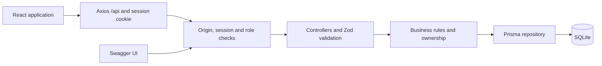
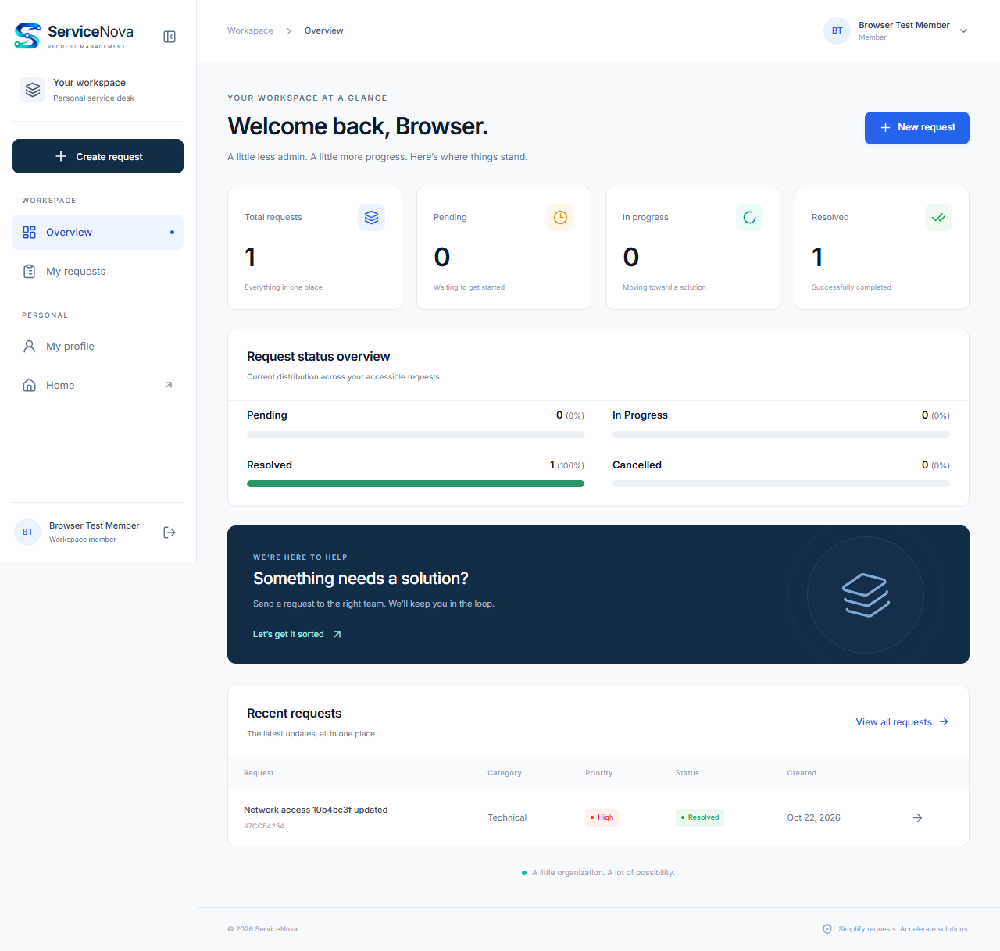
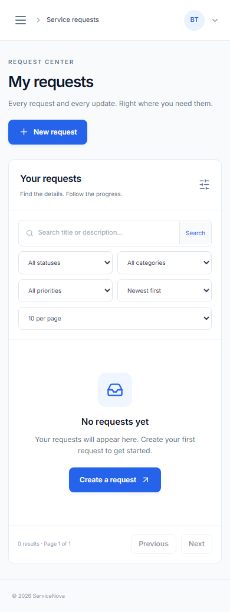
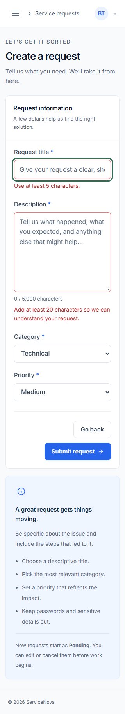
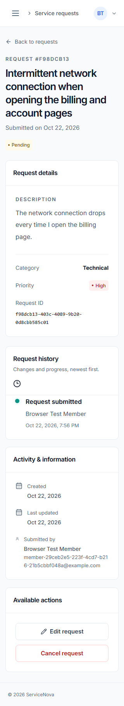

<p align="center">
  
</p>

# ServiceNova

**Simplify Requests. Accelerate Solutions.**

A full-stack **Service Request Management System** built for the VisionRoot Software Engineering Intern technical assignment. ServiceNova gives members a clear way to submit and track requests, while administrators organize incoming work, update statuses and manage workspace members.

The application includes a public Home page, responsive role-based dashboards, persistent request history, a status chart and interactive Swagger documentation. Accounts and requests are stored in SQLite through Prisma; the running application uses real database data rather than an in-memory demo store.

**React 19 &middot; TypeScript &middot; Vite 7 &middot; Express 5 &middot; Prisma 7 &middot; SQLite**

[Repository](https://github.com/UdeshaRashmi/visionroot-software-engineering-assignment) &middot; [API specification](docs/openapi.json) &middot; [Database design](docs/database.md) &middot; [Verification checklist](docs/acceptance.md)

## Contents

- [Features](#features)
- [Roles and business rules](#roles-and-business-rules)
- [Technology and architecture](#technology-and-architecture)
- [Getting started](#getting-started)
- [Administrator setup](#administrator-setup)
- [Environment configuration](#environment-configuration)
- [Database and Prisma Studio](#database-and-prisma-studio)
- [Request history and dashboard](#request-history-and-dashboard)
- [Form validation](#form-validation)
- [Swagger and API reference](#swagger-and-api-reference)
- [Authentication and security](#authentication-and-security)
- [Tests and verification](#tests-and-verification)
- [Screenshots](#screenshots)
- [Project structure](#project-structure)
- [Production setup](#production-setup)
- [Troubleshooting](#troubleshooting)
- [Documentation and demo](#documentation-and-demo)
- [Limitations and future improvements](#limitations-and-future-improvements)

## Features

| Area                 | Included functionality                                                                                |
| -------------------- | ----------------------------------------------------------------------------------------------------- |
| Public website       | Home hero, features, Submit/Track/Resolve workflow, About section and account links                   |
| Accounts             | Registration, login, logout and cookie-based sessions                                                 |
| Member workspace     | Own requests, creation, details, pending-only editing and cancellation                                |
| Admin workspace      | All requests, permitted status transitions, user search/details and display-name editing              |
| Request discovery    | Text search, status/category/priority filters, newest/oldest sorting and server-side pagination       |
| Dashboard            | Role-scoped totals, clickable status breakdown, recent requests and clear empty/error states          |
| Request history      | Paginated creation, edit and status-change events with actor and timestamp                            |
| User experience      | Responsive layouts, larger readable text, soft dashboard colors, toasts and confirmation dialogs      |
| Navigation           | Collapsible desktop sidebar, remembered layout preference, mobile drawer, and logo/Home navigation    |
| Developer experience | Typed REST API, Swagger UI, checked-in migrations, environment templates and isolated automated tests |

Implemented optional enhancements include **request history**, **dashboard status visualization** and **API rate limiting**.

## Roles and business rules

Public registration always creates a `USER`. An administrator is created only through the explicit seed workflow.

| Action                    | Member (`USER`)                                   | Administrator (`ADMIN`)               |
| ------------------------- | ------------------------------------------------- | ------------------------------------- |
| View requests and history | Own requests                                      | All requests                          |
| Create a request          | Yes; owner and initial status are server-assigned | Use a separate member account         |
| Edit request content      | Own request while `PENDING`                       | Use a separate member account         |
| Cancel a request          | Own request while `PENDING`                       | Through permitted status transitions  |
| Change status             | No arbitrary status changes                       | Allowed transitions only              |
| Manage users              | No                                                | Search, view and update display names |
| Change roles              | No                                                | No role-changing API is exposed       |

Allowed transitions:

```text
PENDING     -> IN_PROGRESS or CANCELLED
IN_PROGRESS -> RESOLVED or CANCELLED
RESOLVED    -> terminal
CANCELLED   -> terminal
```

The backend enforces these rules independently of the UI. Other members' request IDs return `404`; role restrictions return `403`. Conditional database updates reject stale actions with `409`.

Cancellation preserves the request and its activity. General request edits cannot change ownership, status or timestamps. Admin screens do not offer member-only creation; opening `/requests/new` as an admin redirects to the request list.

**Categories:** Technical, Billing, Account, Other. **Priorities:** Low, Medium, High.

## Technology and architecture

| Layer                | Technology                                                | Reason for the choice                                                   |
| -------------------- | --------------------------------------------------------- | ----------------------------------------------------------------------- |
| Frontend             | React 19, TypeScript, Vite 7, React Router 7              | Typed UI with a separate REST API and a focused local development setup |
| Styling and feedback | Tailwind CSS 4, custom CSS, Inter, Lucide React, Sonner   | Responsive layouts, locally bundled fonts, icons and notifications      |
| Forms and HTTP       | React Hook Form, Zod 4, Axios                             | Accessible validation feedback and credentialed API requests            |
| Backend              | Node.js, Express 5, TypeScript                            | Clear middleware, controller, service and repository boundaries         |
| Authentication       | Signed JWTs in HttpOnly cookies, bcryptjs                 | Server-verified sessions and password hashing                           |
| Database             | Prisma ORM 7, SQLite, better-sqlite3 adapter              | Typed access, migrations and local setup without a database server      |
| API documentation    | OpenAPI 3.0, swagger-ui-express                           | An interactive endpoint/schema reference                                |
| Verification         | Vitest, Supertest, React Testing Library, Playwright, axe | Unit, API, database, UI and browser/accessibility checks                |



SQLite suits a local assignment demonstration or a small single-server deployment. Production scaling and PostgreSQL portability are discussed in [database design](docs/database.md).

## Getting started

### Requirements

- Node.js matching the package engines: `^22.12.0 || ^24.0.0 || >=26.0.0`.
- npm and Git.
- A writable local directory for SQLite. No external database service is required.

Commands below use **Windows PowerShell** and `npm.cmd` to avoid PowerShell script-policy issues. Use `npm` instead of `npm.cmd` on macOS/Linux; adapt PowerShell-specific file/environment commands accordingly.

### 1. Clone the repository

```powershell
git clone https://github.com/UdeshaRashmi/visionroot-software-engineering-assignment.git
cd visionroot-software-engineering-assignment
```

The directory containing `frontend/` and `backend/` is the **project root** for the following instructions.

### 2. Install and configure the backend

From the project root:

```powershell
cd backend
npm.cmd ci --include=dev
if (!(Test-Path -LiteralPath .env)) {
    Copy-Item .env.example .env
}
```

For **first-time setup only**, generate a random JWT signing key directly into `.env`:

```powershell
node -e "const fs=require('node:fs'),crypto=require('node:crypto');const p='.env';fs.writeFileSync(p,fs.readFileSync(p,'utf8').replace(/^JWT_SECRET=.*$/m,'JWT_SECRET='+crypto.randomBytes(48).toString('hex')));"
```

Keep an existing configured signing key when returning to the project. Replacing it invalidates existing sessions. Real secrets belong in ignored `backend/.env`; `.env.example` is a committed template with blank secret/admin fields.

Apply the checked-in migrations:

```powershell
npm.cmd run db:generate
npm.cmd run db:migrate
npm.cmd run db:status
```

The default database is `backend/prisma/dev.db`. Migrations are additive and do not require resetting existing records. A fresh clone creates a new local database and does not include someone else's accounts.

### 3. Install the frontend

Open another terminal at the project root:

```powershell
cd frontend
npm.cmd ci --include=dev
```

The frontend defaults to `/api` and uses the Vite proxy. Copying `frontend/.env.example` is optional unless you want to override its public API base URL.

### 4. Start both servers

Backend terminal, from `backend/`:

```powershell
npm.cmd run dev
```

Frontend terminal, from `frontend/`:

```powershell
npm.cmd run dev
```

| Service                               | Local address                          |
| ------------------------------------- | -------------------------------------- |
| Application / public Home             | http://localhost:5173                  |
| Swagger UI through the frontend proxy | http://localhost:5173/api/docs/        |
| API liveness                          | http://localhost:3000/api/health       |
| API database readiness                | http://localhost:3000/api/ready        |
| Raw OpenAPI JSON                      | http://localhost:3000/api/openapi.json |

Register at `/register`, or sign in at `/login`. Successful authentication opens `/dashboard` or the protected page originally requested. The sidebar Overview link returns to the dashboard; the logo and Home link return to public Home without logging out.

Use `localhost` consistently: switching to `127.0.0.1` changes the cookie host. Keep one backend and one frontend development server running. Stop them with `Ctrl+C`. Restart the backend after changing its environment configuration.

## Administrator setup

There is **no default administrator account** and no automatic runtime seed.

1. In `backend/.env`, set an unused email address, a name and your own unique random password of **12-128 characters**:

   ```dotenv
   ADMIN_NAME=Your Administrator
   ADMIN_EMAIL=admin@example.com
   ADMIN_PASSWORD=<your-unique-random-password>
   ```

   Replace the password placeholder with your own value. Do not put real credentials in `.env.example` or commit `.env`.

2. From `backend/`, run:

   ```powershell
   npm.cmd run db:seed
   ```

3. Sign in using the email/password you supplied. Remove `ADMIN_PASSWORD` from `.env` after successful seeding if it is no longer needed.

**Existing accounts:** seeding does not reset an existing admin's password or change their name. It also refuses to promote an existing member. Editing `ADMIN_PASSWORD` in `.env` affects a future seed for a new account; it does not change a stored login password. No password-reset workflow is currently implemented.

Use separate member/admin browser sessions when demonstrating their different permissions.

## Environment configuration

Templates: [backend/.env.example](backend/.env.example) and [frontend/.env.example](frontend/.env.example).

| Variable                                      | Purpose                                                                                          |
| --------------------------------------------- | ------------------------------------------------------------------------------------------------ |
| `NODE_ENV`                                    | `development`, `test` or `production`                                                            |
| `PORT`                                        | Backend port; default `3000`                                                                     |
| `JWT_SECRET`                                  | Required random signing key of at least 32 characters                                            |
| `SESSION_TTL_SECONDS`                         | Session lifetime, 300-86400 seconds; default 28800 (8 hours)                                     |
| `FRONTEND_ORIGINS`                            | Comma-separated exact allowed origins; defaults include localhost:5173 and 127.0.0.1:5173        |
| `DATABASE_URL`                                | Local SQLite file URL; default `file:./prisma/dev.db`; explicitly required in production         |
| `ADMIN_NAME`, `ADMIN_EMAIL`, `ADMIN_PASSWORD` | Used only by the explicit administrator seed command                                             |
| `VITE_API_BASE_URL`                           | Public frontend API base URL; default `/api`; never store secrets here                           |
| `API_PROXY_TARGET`                            | Vite process environment override for the development API proxy; default `http://localhost:3000` |

Production requires HTTPS frontend origins. Relative database paths resolve against `backend/`, including when the project directory contains spaces.

For a backend running on a different port, set the matching proxy target **in the frontend terminal** before starting Vite:

```powershell
$env:API_PROXY_TARGET = "http://localhost:3001"
npm.cmd run dev
```

## Database and Prisma Studio

| Model             | Stores                                                                                    |
| ----------------- | ----------------------------------------------------------------------------------------- |
| `User`            | Account details, unique email, password hash, role and session version                    |
| `ServiceRequest`  | Title, description, category, priority, status, owner and timestamps                      |
| `RequestActivity` | Event type, request, optional actor, status transition, changed field names and timestamp |

Users own requests; requests have many activity events. Unique email, foreign keys, enum checks and indexes protect integrity and support retrieval. A request mutation and its activity entry share a transaction, so a failed history write rolls back the request change.

View the schema in [schema.prisma](backend/prisma/schema.prisma), migrations in [backend/prisma/migrations](backend/prisma/migrations), and the relationship/index explanation in [database documentation](docs/database.md).

### Start Prisma Studio manually on Windows

After migrations, open a separate PowerShell terminal at the project root:

```powershell
cd backend
$studioDatabasePath = (Resolve-Path '.\prisma\dev.db').Path.Replace('\', '/')
node scripts/prisma.mjs studio --port 5555 --browser none --url "file:///$studioDatabasePath"
```

Open http://localhost:5555 and select **User**, **ServiceRequest** or **RequestActivity**. If you use a custom database location, replace `.\prisma\dev.db` with the actual path. The command constructs an absolute Windows file URL, including for paths containing spaces.

Studio reads the real local database and runs independently of the frontend/API. Keep its terminal running and stop it with `Ctrl+C`. Database files and journals are ignored by Git. Back up persistent data before schema changes; do not reset the database to resolve a login issue.

## Request history and dashboard

**Find the timeline:** open **My requests** (member) or **All requests** (admin), select a request title, then find **Request history** below **Request details**.

History is paginated, newest first, and includes creation, actual field edits and permitted status changes. Each entry shows its time and actor's current display name. Edited field names are recorded without retaining previous description content. Rejected actions and no-op edits create no events.

Requests created before tracking was introduced receive a clearly labelled **History tracking started** baseline. Earlier changes cannot be reconstructed.

Dashboard totals come from all role-accessible records, independently of the recent-request page. The chart includes Pending, In Progress, Resolved and Cancelled; clicking a chart row or summary card opens the relevant request list. New accounts see empty states rather than invented totals.

## Form validation

Frontend forms use React Hook Form and Zod. Errors appear after a field is touched and on submission; invalid submissions focus the first failing field. Error messages are associated with inputs for assistive technology. The backend validates independently, including requests sent outside the UI.

| Field                 | Rules                                                              |
| --------------------- | ------------------------------------------------------------------ |
| Full/display name     | Trimmed, 2-100 characters                                          |
| Email                 | Valid format, at most 254 characters, trimmed and lowercased       |
| Registration password | 8-128 characters                                                   |
| Login password        | Nonempty, at most 128 characters; verified against the stored hash |
| Request title         | Trimmed, 5-150 characters                                          |
| Request description   | Trimmed, 20-5,000 characters                                       |
| Category / priority   | Documented enum values only                                        |
| Search text           | At most 200 characters; blank search clears the text filter        |

Passwords are never trimmed or normalized. Create/edit forms share the request rules. Browser length limits supplement server validation. Ownership, roles, statuses and timestamps are not accepted as arbitrary editable fields.

## Swagger and API reference

**Open [Swagger UI](http://localhost:5173/api/docs/) with both servers running.**

The same documentation is served at `http://localhost:3000/api/docs/`. For local interactive requests, use the frontend-proxy URL so the browser supplies the configured trusted Origin.

1. Expand `POST /auth/login` and click **Try it out**.
2. Enter your own credentials in the JSON body. If an Origin input is shown, use `http://localhost:5173` or your configured frontend origin.
3. Click **Execute**. A successful login sets the HttpOnly cookie automatically.
4. Test `/auth/me`, request listing/history and permitted mutations. Admin operations require an admin session.
5. Execute `/auth/logout` when finished.

The browser supplies the actual Origin header; an input field cannot spoof it. The Authorize dialog is not needed for cookie login. Execute calls the real API, and mutations persist in the selected database.

**OpenAPI file:** [docs/openapi.json](docs/openapi.json). **Raw endpoint:** `/api/openapi.json`. This file is the single specification source and can also be imported into Postman. The backend build copies it to `dist/openapi.json`; local Swagger assets require no CDN and external spec validation is disabled.

| Method | Endpoint                          | Access / purpose                                            |
| ------ | --------------------------------- | ----------------------------------------------------------- |
| POST   | `/api/auth/register`              | Public member registration                                  |
| POST   | `/api/auth/login`                 | Establish a session                                         |
| POST   | `/api/auth/logout`                | Invalidate the current user's sessions and clear the cookie |
| GET    | `/api/auth/me`                    | Current authenticated user                                  |
| GET    | `/api/requests`                   | Paginated, role-scoped requests                             |
| POST   | `/api/requests`                   | Member creates a request                                    |
| GET    | `/api/requests/metrics`           | Role-scoped dashboard counts                                |
| GET    | `/api/requests/:id`               | Owner/admin request details                                 |
| PATCH  | `/api/requests/:id`               | Member edits their pending request                          |
| DELETE | `/api/requests/:id`               | Member cancels their pending request                        |
| GET    | `/api/requests/:id/history`       | Owner/admin paginated history                               |
| PATCH  | `/api/requests/:id/status`        | Admin status transition                                     |
| GET    | `/api/users`, `/api/users/:id`    | Admin user list/details                                     |
| PATCH  | `/api/users/:id`                  | Admin display-name update                                   |
| GET    | `/api/docs/`, `/api/openapi.json` | Interactive documentation and specification                 |
| GET    | `/api/health`, `/api/ready`       | Process liveness and database readiness                     |

Responses use `{ "data": ... }`; lists also include `pagination: {page,limit,totalItems,totalPages}`. Errors use `{ "error": { "code": ..., "message": ..., "details": ... } }`, with optional field details and appropriate HTTP status codes.

For full query parameters, schemas, examples and business rules, see [API contract](docs/api-contract.md) and [OpenAPI](docs/openapi.json).

## Authentication and security

- JWTs are stored in **HttpOnly cookies**, not localStorage. Only sidebar layout preference uses browser storage.
- Sessions use HS256 with an algorithm allow-list, issuer, audience, expiry and a stored session version. The role is loaded from the database on authenticated requests.
- Logout invalidates all existing sessions for the account. Cookies use SameSite=Lax; production uses Secure and a host-only cookie name.
- Passwords use a domain-separated SHA-256 base64 prehash followed by bcrypt cost 12, avoiding bcrypt's 72-byte truncation.
- Every mutation requires a trusted Origin. CORS is restricted to configured origins.
- Helmet headers, no-store responses, a 32 KiB JSON limit, strict input schemas and safe error responses are included.
- General API rate limiting is 300 requests per 15 minutes per IP; login/registration share a 20-attempt limit. These use per-process state.
- Prisma performs parameterized queries; user projections omit password hashes and session versions.
- Environment files, local databases, generated clients, dependencies and test output are ignored by Git.

These controls are verified through local code review and tests; they do not replace deployment security review. Keep real credentials out of source, screenshots and recordings. See [backend security details](backend/README.md).

## Tests and verification

Latest recorded successful verification:

| Check             | Result                                                                                                                           |
| ----------------- | -------------------------------------------------------------------------------------------------------------------------------- |
| Backend           | **113 tests passed**: 30 isolated service unit tests, 58 API/security/documentation checks, 25 migrated SQLite integration tests |
| Frontend          | **30 tests passed**: validation, access, navigation, role-aware UI, chart and history behavior                                   |
| Chromium          | **12 workflows passed**: six full-stack flows and six desktop/mobile accessibility/keyboard scenarios                            |
| Production builds | Backend TypeScript build and frontend Vite build passed                                                                          |

The counts describe executed checks, not a guarantee of bug-free behavior. See [acceptance checklist](docs/acceptance.md) for evidence and remaining review tasks.

### Backend checks

From `backend/`:

```powershell
npm.cmd test
npm.cmd run build
npm.cmd run format:check
npm.cmd audit
```

### Frontend and browser checks

From `frontend/`:

```powershell
npm.cmd test
npm.cmd run build
npm.cmd run format:check
npm.cmd exec -- playwright install chromium
npm.cmd run test:e2e
npm.cmd exec -- playwright show-report
```

Browser tests start their own migrated temporary database/API on **3010** and Vite on **5174**. These ports must be free. Test-only users/admin credentials stay in the isolated environment; tests do not reset or seed the development database.

The accessibility scenarios cover public pages, member/admin screens, forms/errors, history and dialogs at **1280 x 900** and **320 x 844**. The suite also includes 390px mobile navigation, keyboard focus, Escape behavior and horizontal-overflow checks. See [accessibility review](docs/accessibility.md) for exact scope and limitations.

HTML reports and attached axe results are in ignored `frontend/playwright-report/`; traces and diagnostic screenshots are in `frontend/test-results/`. Automated accessibility passes do not establish full WCAG conformance.

## Screenshots

Actual application captures from isolated, fictional test accounts:

**Member dashboard**



<details>
<summary>View mobile requests, form validation and request history</summary>

<p>
  
  
  
</p>

</details>

## Project structure

```text
visionroot-software-engineering-assignment/
  frontend/
    src/
      components/       Forms, tables, UI states, dialogs and request insights
      contexts/         Authentication state
      hooks/            Resource loading and retry handling
      layouts/          Workspace navigation and sidebar
      pages/            Home, auth, dashboard, requests, users and profile
      services/         Axios client and API helpers
      tests/            Frontend component and behavior tests
      types/ utils/     Domain types, labels and formatting
      images/           Logo and landing-page images
    e2e/                Full-stack and accessibility browser scenarios
    .env.example        Public frontend configuration template
  backend/
    prisma/             Schema and checked-in migrations
    scripts/            Prisma CLI wrapper and OpenAPI build copy
    src/
      controllers/      HTTP input/output
      middleware/       Authentication, roles, origins and rate limits
      repositories/     Persistence boundary and Prisma implementation
      routes/ services/ Endpoint composition and business rules
      validators/       Server-side Zod schemas
      tests/            Unit, API and migrated-database tests
      swagger.ts        Swagger UI and raw-spec routes
    .env.example        Backend configuration template; no real credentials
  docs/
    openapi.json        API specification
    api-contract.md     API behavior, parameters and response shapes
    database.md         Architecture, schema, indexes and migrations
    accessibility.md    Review scope, fixes, commands and limits
    acceptance.md       Verification and submission checklist
    demo-checklist.md   Demonstration walkthrough
    screenshots/        Reviewed application captures
  README.md
```

## Production setup

1. Provide `NODE_ENV=production`, a random signing secret, HTTPS `FRONTEND_ORIGINS` and an explicit persistent SQLite `DATABASE_URL`.
2. Install backend dependencies including development tools for the build/migration steps, generate the client, apply migrations and run `npm.cmd run build`.
3. Deploy the compiled backend, its required runtime dependencies, generated build output and packaged `dist/openapi.json`; start it with `npm.cmd start`.
4. Build the frontend and serve `frontend/dist/` with an SPA fallback to `index.html` and an `/api` reverse proxy to the backend, or configure the public API URL appropriately.
5. Confirm HTTPS, cookie/origin behavior, proxy trust, filesystem permissions, persistent storage and backups in the actual deployment environment.

`vite preview` is a local build-review server. Express proxy trust is disabled by default; configure it only for a known deployment topology. Multi-instance deployment needs shared rate-limit state and an appropriate database strategy. No public deployment is claimed in this repository.

## Troubleshooting

| Problem                                                | Resolution                                                                                                                                                                                    |
| ------------------------------------------------------ | --------------------------------------------------------------------------------------------------------------------------------------------------------------------------------------------- |
| `'vite' is not recognized` or Prisma module is missing | Run `npm.cmd ci --include=dev` in the affected frontend/backend folder, then retry. Dependencies are not included in a clone.                                                                 |
| `.env not found` or invalid `JWT_SECRET`               | Create `backend/.env` from its template and configure a random signing secret using the first-time setup steps.                                                                               |
| Database unavailable or migrations missing             | From `backend/`, run `db:generate`, `db:migrate` and `db:status`, then restart the backend. Confirm the intended writable SQLite path.                                                        |
| API listener cannot start                              | A process may already use the configured port. Stop the duplicate server in its terminal; run one backend instance. Update the Vite proxy if changing `PORT`.                                 |
| Email or password is incorrect                         | Confirm the account exists in this database. New clones do not include old accounts. Register a member or explicitly seed an unused admin email; seeding does not reset an existing password. |
| An admin cannot create/edit request content            | Use a separate member account. Admins manage all requests and status transitions through their permitted screens.                                                                             |
| Swagger mutations return an origin error               | Open `http://localhost:5173/api/docs/` and use the exact allowed frontend origin. Browser Origin cannot be overwritten by a Swagger input.                                                    |
| Swagger returns 404 after an update                    | Restart the backend. If running compiled output, rebuild first.                                                                                                                               |
| PowerShell blocks `npm.ps1`                            | Use `npm.cmd`, as in the commands above.                                                                                                                                                      |
| Vite starts on a port other than 5173                  | Free port 5173 or explicitly update `FRONTEND_ORIGINS` to match the actual UI origin and restart the backend.                                                                                 |
| Browser tests cannot start                             | Free ports 3010/5174 and install Chromium. Restricted environments may require permission to start child processes.                                                                           |

The `/api/ready` endpoint confirms database availability; `/api/health` reports only process liveness. Changing `.env` does not reset accounts or their stored passwords.

## Documentation and demo

| Resource                                      | Purpose                                               |
| --------------------------------------------- | ----------------------------------------------------- |
| [Backend README](backend/README.md)           | Backend setup, security and persistence details       |
| [OpenAPI specification](docs/openapi.json)    | Importable endpoint/schema documentation              |
| [API contract](docs/api-contract.md)          | Authentication, queries, errors and business rules    |
| [Database design](docs/database.md)           | Schema, migrations, relationships and architecture    |
| [Accessibility review](docs/accessibility.md) | Reviewed states, fixes, evidence and remaining checks |
| [Acceptance checklist](docs/acceptance.md)    | Executed verification and submission tasks            |
| [Demo checklist](docs/demo-checklist.md)      | Suggested five-minute walkthrough                     |

**Demo video:** Drive link to be added. Follow the demo checklist and verify that evaluators can open the final video link without requesting access.

For submission, include the repository URL, actual demo Drive URL, complete source, README, environment templates, schema/migrations, API documentation and automated tests. Confirm evaluator access to the repository and video. The assignment repository name is `visionroot-software-engineering-assignment`.

## Limitations and future improvements

- SQLite targets local development or a small single-server deployment; PostgreSQL requires an adapter, migrations, data transfer and new integration verification.
- Rate limits are stored per process; distributed deployment needs a shared store.
- Substring search has limited non-ASCII case folding and no full-text index.
- Password reset, email verification and role-changing workflows are not implemented.
- The member profile is read-only; admin user management supports display-name updates.
- Existing request history starts at its tracking baseline; actor names show current account names and historical description content is not stored.
- Attachments, comments, email notifications, dark mode, Docker and CI/CD are not implemented.
- Physical-device, screen-reader, Firefox/Safari, browser zoom/text scaling, load testing and full WCAG assessment remain outside verified coverage.

Future work can prioritize account recovery, notifications, attachments, full-text search, shared rate limiting, deployment automation and PostgreSQL hosting.
