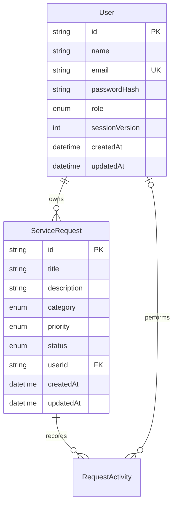
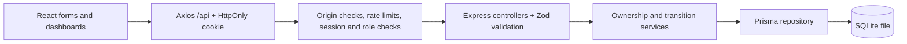

# Database and architecture

ServiceNova uses SQLite and Prisma ORM 7. The runtime SQLite adapter and Prisma CLI share one URL resolver so migrations and the server target the same file, even if the project is in a Windows path containing spaces. Relative URLs resolve against `backend/`. Default: `file:./prisma/dev.db`.



`User.role` is USER/ADMIN. `sessionVersion` starts at 0 and is incremented atomically on logout; JWTs with older versions are rejected. Dates and UUIDs are generated by Prisma/the database, never accepted from request bodies. Public registration sets USER; an explicit admin seed is the only administrator creation workflow provided.

Categories: TECHNICAL, BILLING, ACCOUNT, OTHER. Priorities: LOW, MEDIUM, HIGH. Statuses: PENDING, IN_PROGRESS, RESOLVED, CANCELLED. The SQL migration adds CHECK constraints for enum fields and nonnegative session versions, plus a foreign key that restricts deletion of a user with requests. No user deletion API is exposed. Request DELETE means cancellation and preserves its row.

Indexes cover unique email, user creation order, owner/creation order, request creation order, and status/category/priority with creation order. UUID provides a stable secondary sort key. Substring search uses SQLite LIKE; ordinary indexes do not accelerate arbitrary substring matching. ASCII search is case insensitive; non-ASCII case folding is limited by SQLite. Full-text search is a future improvement.

## Application boundaries



Frontend action visibility is a convenience. Backend services authorize every request; the repository scopes queries before counting/pagination. List rows/counts and dashboard metrics are read inside database transactions. Public user projections explicitly omit hashes and session versions, including owner relations.

Conditional writes protect against stale actions. Edits use one atomic UPDATE matching ID, owner, and PENDING. Transitions match ID and the expected current status (plus owner for member cancellation). The subsequent read occurs inside the same transaction. A lost comparison returns 409 through the service. Duplicate registration is checked both before hashing and through the database unique constraint; the repository maps a concurrent duplicate to 409.

## Migrations and initialization

From `backend/`:

```powershell
npm.cmd run db:generate
npm.cmd run db:migrate
npm.cmd run db:status
```

`db:migrate` runs Prisma **migrate deploy**, applying only checked-in migrations. It does not reset or delete existing data and can be run repeatedly. The initial schema is in `backend/prisma/migrations/20261021000100_init/migration.sql`. `schema.prisma` is the corresponding model definition. Prisma-generated client files, local databases, journals and environment files are ignored by Git.

The CLI wrapper sets `RUST_LOG=info` on its child process to avoid the SQLite migrate-deploy failure documented in [Prisma issue #29355](https://github.com/prisma/orm/issues/29355). This workaround was required and verified in this workspace; it does not change the parent environment or disable TLS checks.

For future model changes, create a new reviewed migration using the Prisma CLI (for example, `node scripts/prisma.mjs migrate dev --name describe_change`). Do not edit an already-applied migration. Back up persistent data before schema changes. Production must explicitly set a SQLite `DATABASE_URL` pointing to a writable persistent disk and apply migrations before starting the API. Startup verifies table availability and fails clearly when initialization is missing.

## Administrator setup

Set `ADMIN_NAME`, `ADMIN_EMAIL`, and `ADMIN_PASSWORD` in ignored `backend/.env`; use a password of 12–128 characters. Then run `npm.cmd run db:seed` from `backend/`.

The seed creates an administrator only when that email is unused. If it already belongs to an admin, the command succeeds without changing name/password. If it belongs to a member, the command refuses to promote it. No default administrator password or automatic runtime seed exists. Remove ADMIN_PASSWORD from the environment file after seeding if it is no longer needed. Passwords use the shared hashing helper; never insert plaintext passwords or hashes from another bcrypt convention.

## Testing and portability

Real-database tests allocate a unique temporary SQLite file, apply the actual checked-in migrations, and inject the Prisma repository into Express. They cover persistence, auth, ownership, search/filter/pagination, status changes, database constraints, duplicate email races, conditional writes and controlled seeding. The test helper verifies the temporary directory before cleanup and does not reset the development database.

Browser tests start a separate migrated temporary database/API (3010) and Vite (5174). Their admin credentials are fixed test fixtures only; they are never inserted into the development database.

SQLite is suitable for local demonstration and a single small server. PostgreSQL migration requires changing the datasource/adapter, generating PostgreSQL-specific migrations, transferring data, and rerunning integration tests. The domain, API and repository contract are reusable; SQLite SQL migrations and case-sensitivity semantics are not portable unchanged. Multi-instance rate limiting and higher write concurrency also need deployment-specific work.

## Request activity

The additive `20261022000100_request_activity` migration adds RequestActivity without replacing requests or users. An auto-incrementing activity ID provides stable newest-first pagination with an index on `(requestId, id)`. Events reference the request (cascade on deletion) and optional actor (set null on deletion). Only actor ID/current display name is exposed. Changed fields contain names, not historical descriptions. Each mutation and event share a transaction; failed writes roll back both. Existing requests receive a TRACKING_STARTED event at migration time with their current status. Earlier changes are not fabricated.
